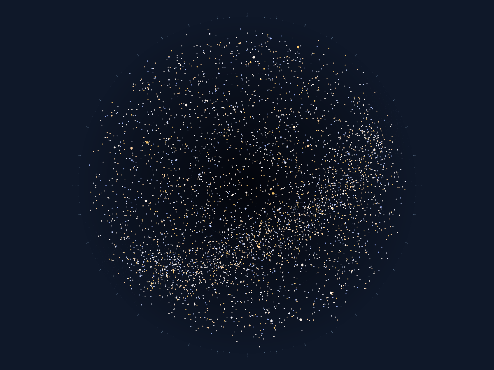

### 今夜 · 星夜 夜半



```
                                            .                                                   
 .          .                      .             +                    . .   .         .         
                        .  ..           .    .  .             . .     ..       .                
 .          .  ..           ...       .    ..         ..      +  ..    . .   .    ..   ..   ..  
 . . .  .  +      .  .  . ..  .  . .           .*   .  ..    . .  ..   . .    . +    +  .      .
 . .  . ..    .   .  . ...  * .   ..  ...  . ...   +  ..   .   .. .. .+     .    . . .  .   . . 
.   . . ....+..+..    .  .. .. . .... +. ... .. ... ...   .   . . . .. ..... . .. .         ..  
... .+ +.. ..+.... . . . ...   . ++.. .....+... .....+ ...  .... ..... ..  ...   ....  . . . ...
  .... . .  . ..+ .... ....  ... ..... ...... . .. ...+. + . ..+..     ...++..  ... .  ..    .  
 ...... .....  ....... ...............+..+.....+.........  ........ .++. .. . .  .. + . +.....  
···.·........·..+.....·.+.+·........+......++...+..·...··.+.+.·....+.·....··..·.·...·.......·.. 
   ..  ..  ... .+  ...... ...................*....+..........+ ...... .+ .      .. .......+.....
 . ..  .........  ... .+..........+..................+..... .. .*. ... .....   .. ..+  . . .+ . 
    ..... *...**..  + ..+.....................+ ... .+.. . .. ... ... ......+. ...   .  ...+.++ 
..   .....+.  ... .. .............+....+.+.+ ............... ...+.. ..+..+. . . .. ......+..+.. 
...... .....  ..............*...*. .. +..+.. .++....++.........+... ................. .+.....   
..   ..+ .........*... +..+....... ...... .........+........+....+... ...... ..* .  ....+.... ..
. ...... ....*.. ........+...... . ...*. .....+....+.............. ... .. ...... . ..*. .... .. 
. + ..... .+... ..+*.........+..... ..... .... . ....++..+...........*..... .+...+. .. .. . ....
·...+.....+.·............+............··.....+......+.....*........ ...·....+*·..·..· ....·.··. 
  +........... ... .............+.....   ... ....+.+...+...+.......... .+.+.  .............+ . .
++.......+....  ............. +..... ...... . . ...+..+.+......+.. ....... .*... ..+ ..... .+...
 * ......+.. ......................+. +... ..+.. .+ ................. . ..... .. ....... ...... 
....... +... .....+.+.....+.+...... . ...+.+ ....+. . ................ .....+........+ ......+..
 ....... +.....+......+.. ......+ ..+.*.. ...*.+.....+. .+.*.+...........  + .+.. .....+....... 
. ...*......  .. ........  +.  .......+..+* .+. ....... . ... .. .+...... . ..   ....  .. ....+.
..+.. + .. . .. .. .. .......... ... ..  +    .. . ... ....... ..   ...... ...+.. ....... . .   
 .   . +. .  ..  .. ..... ...  .....  ..  .  .. .    .    . ... + .  ... ..  .. .   .. .   +  . 
─ ─ ─ ─.─ . . ─ ─ ─ ─ ─ ─ ─ ─ . ─ ─ ─ ─.─ ─ ─ . ─ ─ ─ ─ ─ ─ ─ . ─ ─ ─ ─ ─ ─ ─ . ─ ─.─ ─ ─.─.─ ─ 
N                       E                       S                      W                        
```

- 天空亮度 **21.9** mag/arcsec² ｜ 极限星等 **6.5** ｜ 可见星约 **2658** 颗 ｜ 银河 可见
- 孤灯：alt -55.0° / az 0.0° / -26.7 等

| 月 | 昼长(h) | 正午太阳高度 | 极昼/极夜 | 夜可见星 |
|---|---|---|---|---|
| 霜月 | 12.6 | 61.1° | 无 | 2658 |
| 雪月 | 13.6 | 71.5° | 无 | 2658 |
| 芽月 | 14.3 | 77.6° | 无 | 2658 |
| 雨月 | 14.3 | 77.6° | 无 | 2658 |
| 花月 | 13.6 | 71.5° | 无 | 2658 |
| 长月 | 12.6 | 61.1° | 无 | 2658 |
| 暑月 | 11.4 | 48.9° | 无 | 2658 |
| 伏月 | 10.4 | 38.5° | 无 | 2658 |
| 果月 | 9.7 | 32.4° | 无 | 2658 |
| 叶月 | 9.7 | 32.4° | 无 | 2658 |
| 雾月 | 10.4 | 38.5° | 无 | 2658 |
| 炉月 | 11.4 | 48.9° | 无 | 2658 |

> 简化模型：圆轨道近似 + 经验天光（±0.5 等）；星表由 seed 确定性生成，是本世界的计算结果，不是真实天空。
