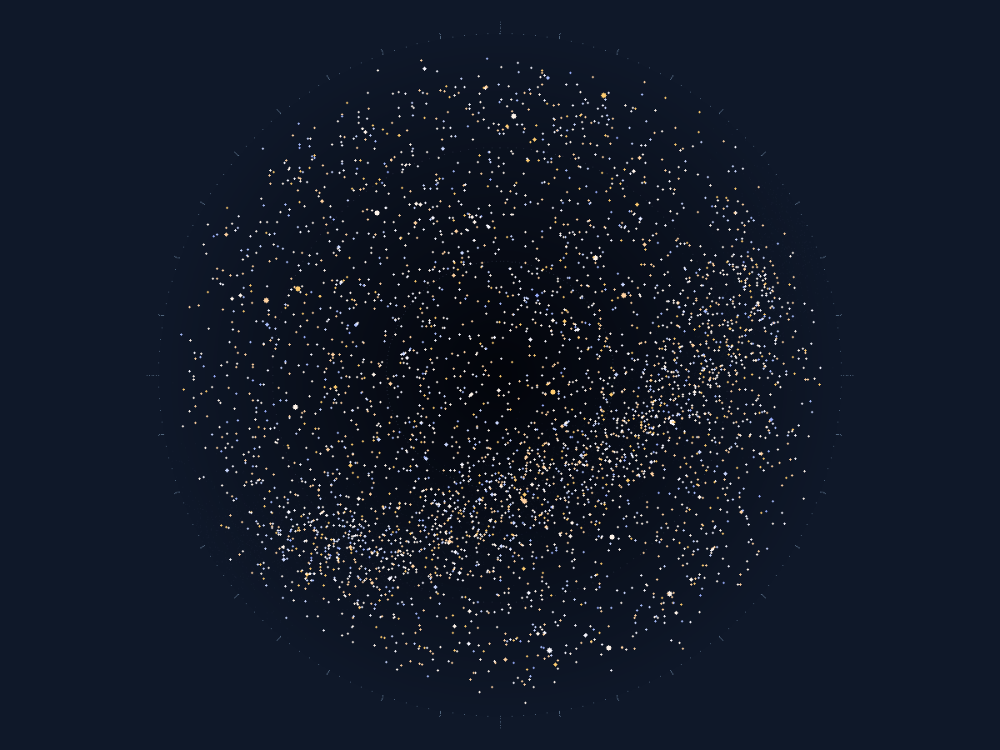
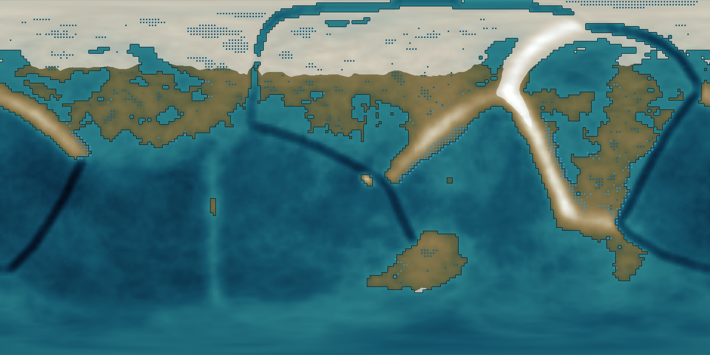
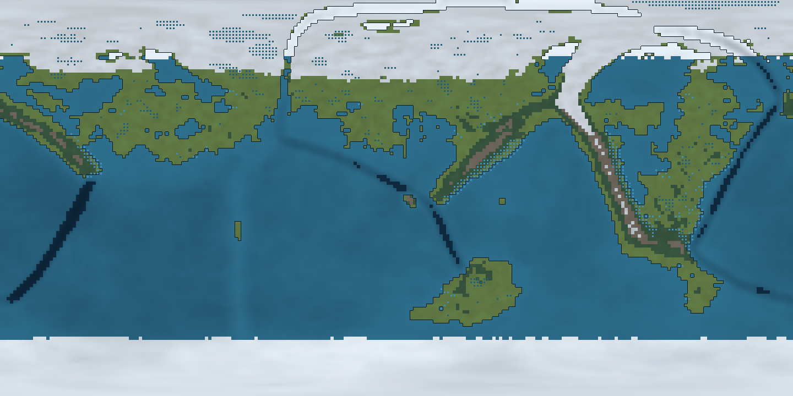
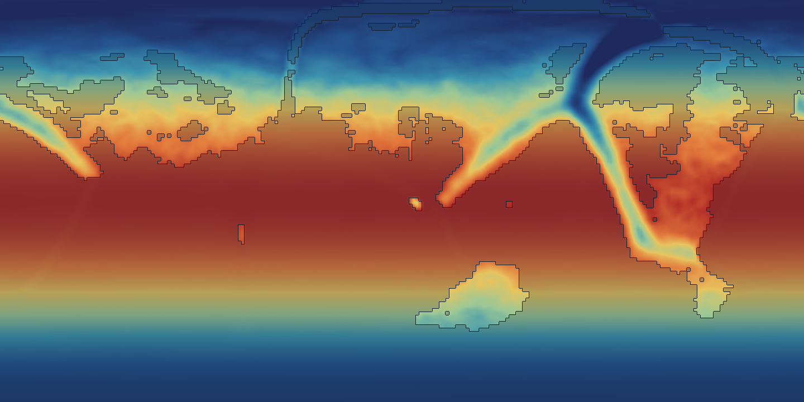
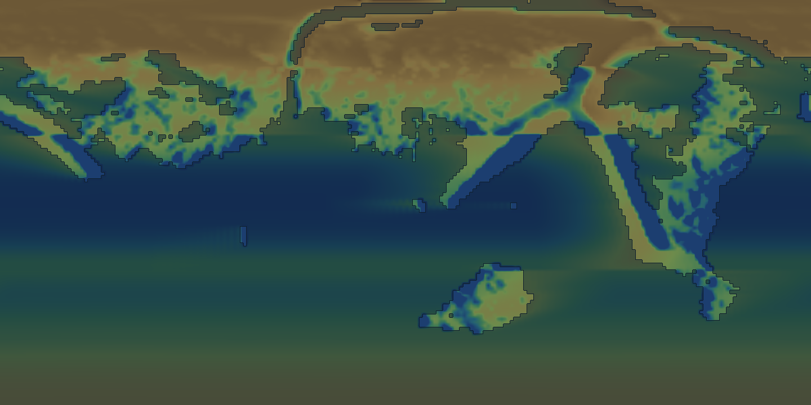
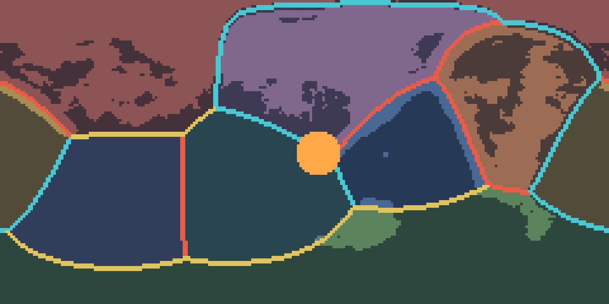
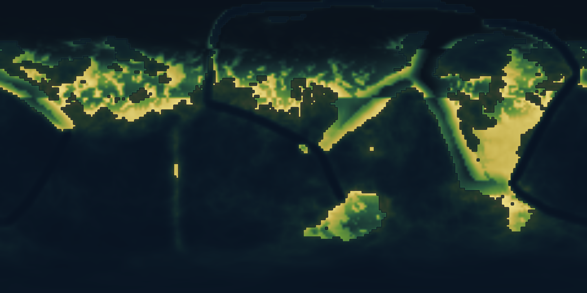
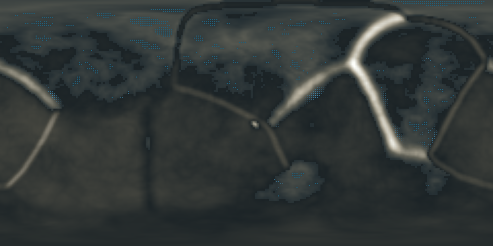
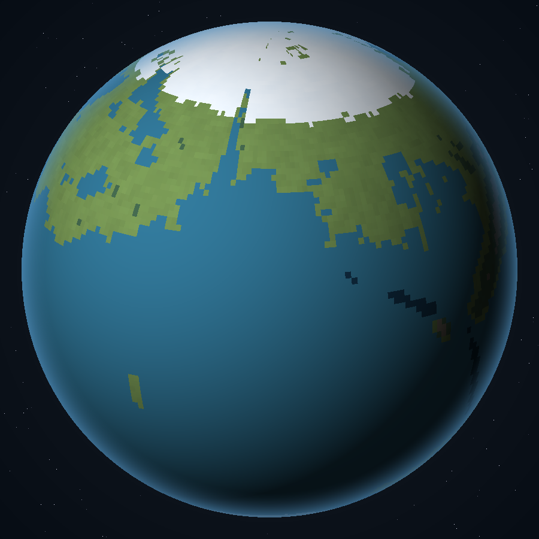

# 星夜 · 单星对照世界

> 一颗太阳，一夜两千多颗星，一条横过天顶的银河。

`v1.1.4` ｜ 2026-11-04 ｜ 自洽评分 **100/100**（可发表） ｜ 反常识度 **0/100** ｜ 生成：盘古

美学基调：`深黛` · `银白` · `松绿` · `暖夜蓝`

---

## 第一眼 · 星夜



```
                                            .                                                   
 .          .                      .             +                    . .   .         .         
                        .  ..           .    .  .             . .     ..       .                
 .          .  ..           ...       .    ..         ..      +  ..    . .   .    ..   ..   ..  
 . . .  .  +      .  .  . ..  .  . .           .*   .  ..    . .  ..   . .    . +    +  .      .
 . .  . ..    .   .  . ...  * .   ..  ...  . ...   +  ..   .   .. .. .+     .    . . .  .   . . 
.   . . ....+..+..    .  .. .. . .... +. ... .. ... ...   .   . . . .. ..... . .. .         ..  
... .+ +.. ..+.... . . . ...   . ++.. .....+... .....+ ...  .... ..... ..  ...   ....  . . . ...
  .... . .  . ..+ .... ....  ... ..... ...... . .. ...+. + . ..+..     ...++..  ... .  ..    .  
 ...... .....  ....... ...............+..+.....+.........  ........ .++. .. . .  .. + . +.....  
···.·........·..+.....·.+.+·........+......++...+..·...··.+.+.·....+.·....··..·.·...·.......·.. 
   ..  ..  ... .+  ...... ...................*....+..........+ ...... .+ .      .. .......+.....
 . ..  .........  ... .+..........+..................+..... .. .*. ... .....   .. ..+  . . .+ . 
    ..... *...**..  + ..+.....................+ ... .+.. . .. ... ... ......+. ...   .  ...+.++ 
..   .....+.  ... .. .............+....+.+.+ ............... ...+.. ..+..+. . . .. ......+..+.. 
...... .....  ..............*...*. .. +..+.. .++....++.........+... ................. .+.....   
..   ..+ .........*... +..+....... ...... .........+........+....+... ...... ..* .  ....+.... ..
. ...... ....*.. ........+...... . ...*. .....+....+.............. ... .. ...... . ..*. .... .. 
. + ..... .+... ..+*.........+..... ..... .... . ....++..+...........*..... .+...+. .. .. . ....
·...+.....+.·............+............··.....+......+.....*........ ...·....+*·..·..· ....·.··. 
  +........... ... .............+.....   ... ....+.+...+...+.......... .+.+.  .............+ . .
++.......+....  ............. +..... ...... . . ...+..+.+......+.. ....... .*... ..+ ..... .+...
 * ......+.. ......................+. +... ..+.. .+ ................. . ..... .. ....... ...... 
....... +... .....+.+.....+.+...... . ...+.+ ....+. . ................ .....+........+ ......+..
 ....... +.....+......+.. ......+ ..+.*.. ...*.+.....+. .+.*.+...........  + .+.. .....+....... 
. ...*......  .. ........  +.  .......+..+* .+. ....... . ... .. .+...... . ..   ....  .. ....+.
..+.. + .. . .. .. .. .......... ... ..  +    .. . ... ....... ..   ...... ...+.. ....... . .   
 .   . +. .  ..  .. ..... ...  .....  ..  .  .. .    .    . ... + .  ... ..  .. .   .. .   +  . 
─ ─ ─ ─.─ . . ─ ─ ─ ─ ─ ─ ─ ─ . ─ ─ ─ ─.─ ─ ─ . ─ ─ ─ ─ ─ ─ ─ . ─ ─ ─ ─ ─ ─ ─ . ─ ─.─ ─ ─.─.─ ─ 
N                       E                       S                      W                        
```

**今夜**：极限星等 6.5 ｜ 地平线上约 2658 颗 ｜ 银河 可见 ｜ 天空亮度 21.9 mag/arcsec²

一天 24 小时，一年 12 个月（365.256 天）；暗空：极限星等约 6.5，肉眼可见约 2658 颗，银河横过天顶。

> 星表由 seed 确定性生成、按本世界观测点实算。它是这个世界的计算结果，不是地球的天空，也不是真实星表。

---

**如果一颗太阳就足够让夜空变成这样，那三颗太阳的世界里，他们抬头看见的是什么？**

抬头：一条灰白色的带子横过天顶，密得发糊；低头：脚边只有一道影子。

## 零 · 创作路线

✓ 斧1 混沌（定调） ｜ ✓ 斧2 分判（定天） ｜ **▶** 斧3 立律（定法） ｜ ✓ 斧4 炼质（定料） ｜ ✓ 斧5 化生（定活） ｜ ✓ 斧6 启智（定人） ｜ ✓ 斧7 演界（定史）

当前停在 **斧 3 立律**：还缺 1 项（physics.constants（改过的常数为 0——这是地球换皮））

### 必然推论（1 条，已回写 0 条）

| ID | 推论 | 强度 | 断言 |
|---|---|---|---|
| E19 | 不动的海 | 很可能 | 海面几乎不涨落，只有风浪；没有潮间带生态。 |

推论不是灵感，是从已立之律**算出来**的：设定 → 现象。

**下一步**：`axioms --axe 3 --roll 3` —— 立律斧的积木全在物理域

## 一 · 核心悖论

| 项 | 内容 |
|---|---|
| 一句话悖论 | 这个世界没有异常——而它的全部神话、历法与航海都压在一件赫利孔人没有的东西上：一条看得见的银河 |
| 凭什么可能 | 不改任何常数：G、c、α 与地球相同，行星 1R⊕/1M⊕、一天 24 小时、倾角 23.4°；只用一颗 1.0 L☉ 的 G2V 和一层干净的 101 kPa 大气，把暗空还给居民 |
| 原始意图 | 造一个什么都没改的世界：一颗太阳、一天二十四小时。它存在的意义是当对照组 |

**禁忌**：魔法、超自然力量、外星文明干预、时间旅行

## 二 · 三律自检

| 律 | 内容 |
|---|---|
| 逆行律 | ✓ 这个世界没有异常——而它的全部神话、历法与航海都压在一件赫利孔人没有的东西上：一条看得见的银河 |
| 代价律 | ✓  |
| 痕迹律 | ✓ 夜里天上全是星：地平线上数不清，天顶最密的地方连成一条灰白色的带子，那是「星河」——星图上叫银河，土名与学名都不许私占；一年四季的星图不同；霜月的夜空最清，伏月的夜最短但最暖，银河最粗的一段正在天顶；没有月亮，潮汐只有太阳那一份，很小：海边的人按星位而不是按潮水记事；「看天时」是每天熄灯的一小时，城里不许点灯，违者罚钱——为了让所有人看得见银河 |

## 三 · 宇宙

**框架**：single-star-terrestrial ｜ **拓扑**：三维欧氏空间；一颗 G2V 居于原点，行星沿圆轨道绕行 ｜ **有恒星**：是

### 恒星

| 名 | 光谱型 | 质量 | 光度 | 表面温度 | 轨道 |
|---|---|---|---|---|---|
| 孤灯 | G2V | 1.0 M☉ | 1.0 L☉ | 5780 K | 0.0 AU / 365.256 d |

### 天体

| 名 | 类型 | 半径 | 质量 | 表面重力 | 特征 |
|---|---|---|---|---|---|
| 星夜 | planet | 6371.0 km | 1.0 M⊕ | 1.0 g | 对照组行星。全部取地球值，唯一的差别是它只有一颗太阳——于是夜空是黑的，星是满的 |

### 地形与生物群系

**星夜**：深蓝海（#12324A） → 浅湾（#2E6F8E） → 草原（#6E8B4E） → 针叶林（#3F6048） → 裸岩（#7C7368） → 雪脊（#D8E2EA）

### 大气

- **星夜**：101.3 kPa，标高 100 km；成分 N2 78.0%、O2 21.0%、Ar 1.0%

### 抬头能看见什么

- 夜里天上全是星：地平线上数不清，天顶最密的地方连成一条灰白色的带子，那是「星河」——星图上叫银河，土名与学名都不许私占
- 一年四季的星图不同；霜月的夜空最清，伏月的夜最短但最暖，银河最粗的一段正在天顶
- 没有月亮，潮汐只有太阳那一份，很小：海边的人按星位而不是按潮水记事
- 「看天时」是每天熄灯的一小时，城里不许点灯，违者罚钱——为了让所有人看得见银河

### 历法

| 项 | 值 |
|---|---|
| 一天 | 24.0 小时 |
| 一年 | 365.256 天 |
| 分月 | 12 个月 × 30.438 天 |
| 纪元 | 星夜纪 |

## 四 · 物理与数学

| 常数 | 地球 | 本站 | 倍率 | 为什么改 |
|---|---|---|---|---|
| G | 6.674e-11 m3kg-1s-2 | 6.674e-11 m3kg-1s-2 | 1.00 | 未改动。对照组的意义就在于常数与地球完全一致，任何差异都只能来自「只有一颗太阳」 |
| c | 2.998e8 m/s | 2.998e8 m/s | 1.00 | 未改动。星空的红移与地球同构，测距方法可直接沿用 |
| α | 7.297e-3 | 7.297e-3 | 1.00 | 未改动。元素表与光谱线与地球同构 |

### 定律

- **引力**（无）：平方反比，G 与地球相同
  - 后果：1 R⊕ 的岩石行星表面重力 1.0 g，无异常
- **热力学第二定律**（标准）：完整保留
  - 后果：生态系统遵循能量金字塔，与地球同构

**守恒律**：能量与角动量严格守恒。这个世界的物理没有为任何人让路。

### 数学

| 项 | 值 |
|---|---|
| 几何 | 欧氏几何，三维平直空间 |
| 数系 | 实数；但计数传统源自双星，采用「双进制」口算，八与十六在他们的语言里是「整」的意思 |
| 异常 | 由于一年恰好等于八个双星周期，他们的数论中「8」具有近乎神圣的地位，所有度量衡以 8 为基 |
| 后果 | 度量衡采用八进制：一尺 = 8 寸，一斤 = 8 两。换算成地球单位会产生持续的误差，这也是他们无法发展出精密钟表的原因之一 |

## 五 · 物质

| 项 | 值 |
|---|---|
| 元素表 | 与地球同构，1–118 号元素齐全，无超重稳定岛 |
| 溶剂 | 水 |
| 键合 | 共价键 / 离子键 / 氢键，与地球相同 |

### 标志性材料


### 元素配比 · 行星本体

| 项 | 值 |
|---|---|
| 铁 | 32.10% |
| 氧 | 29.67% |
| 硅 | 16.10% |
| 镁 | 15.40% |
| 钙 | 1.92% |
| 硫 | 1.88% |
| 铝 | 1.45% |
| 镍 | 1.40% |
| 碳 | 0.05% |
| 氢 | 0.03% |


### 元素配比 · 大气

| 项 | 值 |
|---|---|
| 氮 | 78.00% |
| 氧 | 21.00% |
| 氩 | 1.00% |


### 元素配比 · 海洋

| 项 | 值 |
|---|---|
| 水 | 96.50% |
| 氯化钠 | 3.50% |


## 六 · 生命

| 项 | 值 |
|---|---|
| 能量货币 | ATP 等价物 |
| 代谢 | 光合—摄食—分解三级，与地球同构；没有第二条能量通道 |
| 遗传载体 | DNA |

**承载力**：陆地 NPP 56.54 Gt C/yr ｜ 可采收 1.0% ｜ 维持型上限约 **55.8 亿人**
> 口径：Miami 模型（温度/降水取小）积分到陆地；可采收比例 1.0%；维持 2500 kcal/日、宽裕 3500 kcal/日

### 生命基座

| 项 | 值 |
|---|---|
| 基座 | 碳基 |
| 主元素 | 碳 |
| 结构元素 | 碳 |
| 溶剂 | 水 |
| 限制 | 0.3–1.6 g 重力、240–320 K 液水窗口；与地球同构 |

对照组不需要新化学：碳链代谢、硅氧骨架都不用，一条 DNA 走到底。

| 项 | 值 |
|---|---|
| 氧 | 65.0% |
| 碳 | 18.0% |
| 氢 | 10.0% |
| 氮 | 3.0% |
| 其他 | 2.0% |
| 磷 | 1.0% |
| 硫 | 1.0% |


**光合**：色素「叶绿素 a/b」，吸收 ；观感：—

### 生态金字塔

- **生产者** 0.89：
- **初级消费者** 0.1：
- **顶级消费者** 0.01：

**智慧生命**：星夜人 —— 会写星图表的物种；历法是星位的副产品

## 七 · 文明

| 项 | 值 |
|---|---|
| 名称 | 看天的人 |
| 技术路径 | 天文—航海—钟表：先有星图，后有远洋，最后才有蒸汽机 |
| 计时 | 一天 24 小时，一年 12 个月；夜里用星位定时，白天用日晷 |
| 能源 | 恒星辐照的直接存量（风、水、生物质），尚未进入化石燃料时代 |
| 社会 | 以「守灯人」为核心的城市联盟：守灯人负责每晚熄灯一小时，违者罚钱 |
| 禁忌 | 不许在「看天时」点灯；不许给星起私名——星名属于全体 |

## 八 · 行星地图

| 项 | 推演结果 |
|---|---|
| 海洋 / 陆地 | 67.4% / 32.6% |
| 海平面 | 1.651 km ｜ 水量 1.15e+09 km³ |
| 最高峰 / 最深海 | 8.8 km / 17.372 km |
| 均温 / 年降水 | 287.32 K / 899.9 mm |
| 河流 / 湖泊 | 631 格 / 2.3% 面积 |
| 宜居度 | 均值 0.2814 ｜ 中位 0.1299 |
| 构造 | 8 块板 ｜ 汇聚 460 ｜ 张裂 750 ｜ 热点 241 |

**推演链**：板块 → 盆地 → 水量定海平面 → 年辐照定温度 → 风带与迎风坡定降水 → 洼地填充定河网 → 高程带 × 湿度定群系。 摘要哈希 `280287df`（同 seed 可复算）。

**地图体检**：✓ M01 海洋占比 67.4%（水量 1.15e+09 km³）；✓ M02 最高峰 8.80 km / 重力上限 8.80 km；✓ M03 均温 287.3 K / 派生 287.8 K；✓ M04 河流格 631；✓ M05 群系覆盖 100%；✓ M06 平均宜居度 0.28



*高程与海平面 · 晕渲 + 海岸线 + 河网*



*群系 · 世界自己声明的生物群系 + 极冰 + 河网*



*年平均温度 · 年辐照、温室与海拔递减*



*年降水量 · 风带、海陆分布与雨影*



*构造 · 板块、汇聚/张裂/转换边界与热点*



*宜居度 · 温度、溶剂、光照、海拔的乘积*



*晕渲地形 · 不带群系色的纯地貌*



*正射球面 · 从太空看这颗行星*

## 九 · 历史

- **观星期**（约 3000 年前）
- **远航期**（约 400 年前）
- **熄灯法**（约 120 年前）

## 十 · 自洽性审查

**100/100**（可发表）｜ fatal 0 ｜ warn 0

反常识度 **0/100**（推荐区间 40–70，当前判定：仍是地球换皮）

全部通过。

### 派生量核算

| 天体 | 半径 | 质量 | 密度 | 重力 | 逃逸速度 | 平衡温度 |
|---|---|---|---|---|---|---|
| 星夜 | 1.0 R⊕ | 1.0 M⊕ | 5.514 g/cc | 1.0 g | 11.19 km/s | 254.8 K |

G'/G = 1.0 ｜ 总光度 1.0 L☉

| 天体 | 采用温室 | 成分估算 | 来源 |
|---|---|---|---|
| 星夜 | 33.0 K | 无法估 | 声明值 |


| 恒星 | 质量 | 光度 | 主序寿命 |
|---|---|---|---|
| 孤灯 | 1 M☉ | 1 L☉ | 10 Gyr |

宜居带 0.953–1.374 AU（Kasting 保守区间：1.1–0.53 倍通量）

## 十一 · 灵感来源

- [Earth — 天体生物学基线](https://science.nasa.gov/earth/) —— 1 R⊕ / 1 M⊕ / 1 AU / 1 L☉ 是最省事的自洽解，也是最好的对照组
  - 用在哪里：全部取地球值，不引入任何张力；差异只由「三颗恒星」与「一颗恒星」的对照产生
- [Bortle scale — 夜空亮度分级](https://en.wikipedia.org/wiki/Bortle_scale) —— 暗空（Bortle 1–2）极限星等约 6.5–7.0，银河可直视
  - 用在哪里：把基线天光定在 21.9 mag/arcsec²，作为 sky 模块的暗空锚点
- [Milky Way — 银河的可见条件](https://en.wikipedia.org/wiki/Milky_Way) —— 银河是银道面上密集暗星与尘埃的叠加，需要暗空才能成带状
  - 用在哪里：星表里按银道面撒 35% 的成员星，让「银河」在图上是画出来的，不是贴上去的
- [Light pollution — 天光与极限星等的关系](https://en.wikipedia.org/wiki/Light_pollution) —— 天光亮 1 mag/arcsec²，肉眼极限星等约降 0.5–1 等
  - 用在哪里：定下 sky 模块的 −0.9 等/mag 斜率；城市灯与恒星散射走同一条公式

## 名场面

「看天时」那一刻，全城熄灯。城市从脚下暗下去，银河从头顶亮起来，有人当场哭。

---
*由盘古生成。设定变更请改 world.json 后重跑脚本，勿手改本文。*