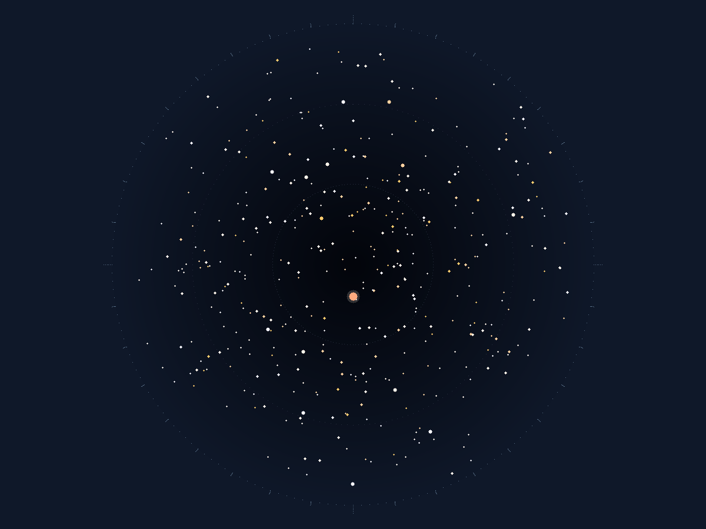

### 今夜 · 赫利孔 夜半



```
                                                                                                
      .                                                        .              .                 
                                                                                                
            + .   +        +            +.                          +                           
+                       .   +        +        + @                            + .   +            
           +           .+                                                    ++                 
 .           .     +    +   .  +                          .                                   ++
   +  .  .  *   +    .  .   *                          *            .+                *         
    +     . .  + +             +          + + *           + +           +       +  .+  .    *   
   .   + +  .             .  + + ..      +            +             .   .        .   +   + +    
········· ·····*.············ ·······++······.· ·····.···+···.·.··· ············+····.········· 
  .  +. ++      *                .  .       +        +    + .                 +         +       
       .   .           + +        +     +        + .   *      +*         .  .+ *     +. *  *    
+.+    *+   .      +    +   .      +.        .+ .+      +    *  +    ..   .                     
                +       + .     .        . .  ..       +   .     .+   .      +    + +    +   .+ 
 +.          * +    +  +    .         +    .  +  +   +   . +  .      +     .   +    *  +        
    +    +   *    + . +        +  .  .     *        .   +   .  .    .+  .  *   ++               
*           ++   +              +              +      +       . + + +  +    +         +     +   
                          ..  .+   .    . +     +         +   +    .   + .         .            
······+·+ ···········+······· ·+.······+······. ··+·*········.+···· ····+.·········+· ····+.··· 
   *        .      *        .   .++.         .      + . *..            +   ++          .      * 
          .         +                .    .      +       +     +     + + +      . +. .+   +     
    +. .      +   +   .    .   +.        *.     .             +.+    +  +    +          +       
   +           +.     * .    +   +       .+ .              .  + +              .            .   
++           +  .+..+          +           .  ..  +*         +.        +  +      +            . 
  .                     +              .    +         +                             .    +      
  +          +.     + .   + .          .        *  .+         + +     .                   + + . 
             +  +                                                 +             .+  +           
─ ─ ─ ─ ─ . + ─ ─ ─ ─ ─ ─ ─ ─ ─ ─ ─ ─ ─.─+─ ─ ─ ─ ─ ─ ─ ─ ─ ─ ─ ─ ─ ─ ─ ─ ─ ─ ─ ─ ─ ─ ─ ─ ─ ─ ─ 
N                       E                       S                      W                        
```

- 天空亮度 **19.05** mag/arcsec² ｜ 极限星等 **3.94** ｜ 可见星约 **219** 颗 ｜ 银河 不可见
- 长明：alt -78.0° / az 0.0° / -26.1 等
- 短烛：alt -78.0° / az 0.0° / -25.8 等
- 远灯：alt +78.0° / az 180.0° / -16.3 等
- 厄瑞玻斯：alt -78.0° / 相位 新月 / +1.4 等

| 月 | 昼长(h) | 正午太阳高度 | 极昼/极夜 | 夜可见星 |
|---|---|---|---|---|
| 第 1 月 | 16.0 | 85.0° | 无 | 219 |
| 第 2 月 | 16.3 | 85.2° | 无 | 219 |
| 第 3 月 | 16.3 | 85.2° | 无 | 219 |
| 第 4 月 | 16.0 | 85.0° | 无 | 219 |
| 第 5 月 | 15.4 | 71.0° | 无 | 219 |
| 第 6 月 | 15.1 | 61.2° | 无 | 219 |
| 第 7 月 | 15.1 | 61.2° | 无 | 219 |
| 第 8 月 | 15.4 | 71.0° | 无 | 219 |

> 简化模型：圆轨道近似 + 经验天光（±0.5 等）；星表由 seed 确定性生成，是本世界的计算结果，不是真实天空。
