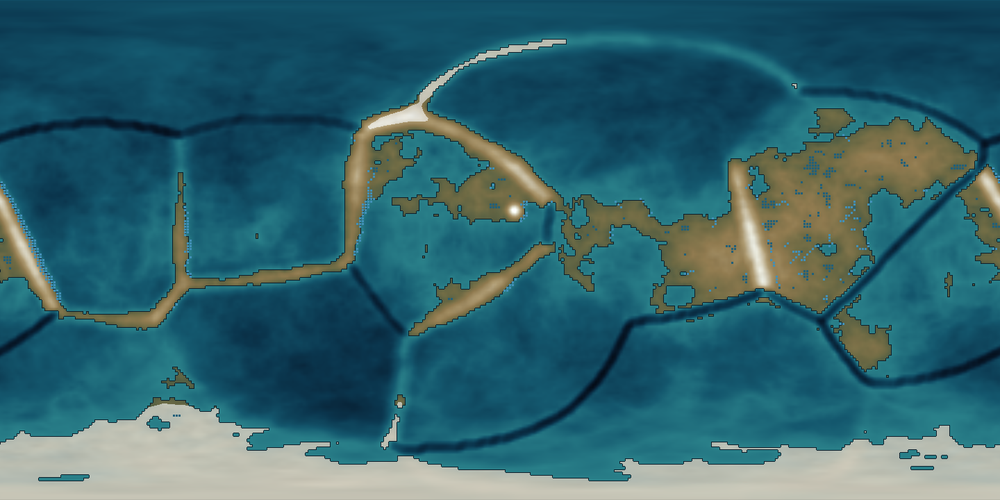
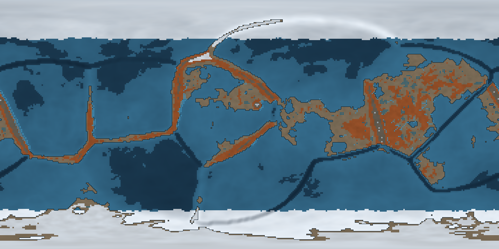
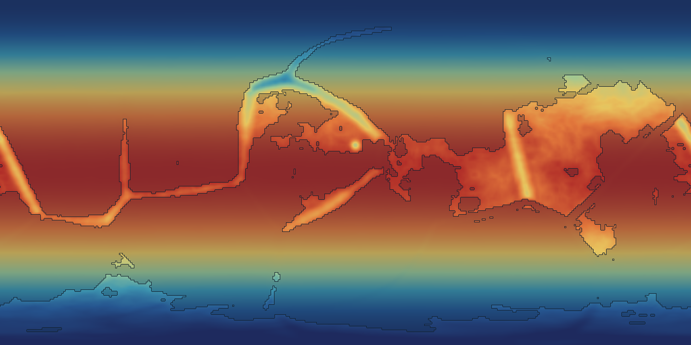
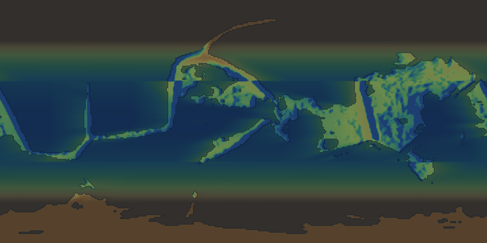
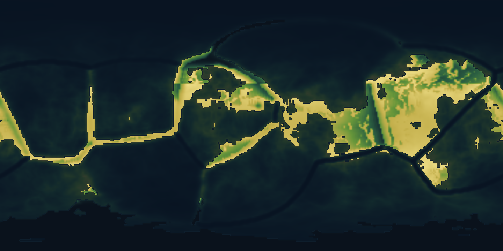
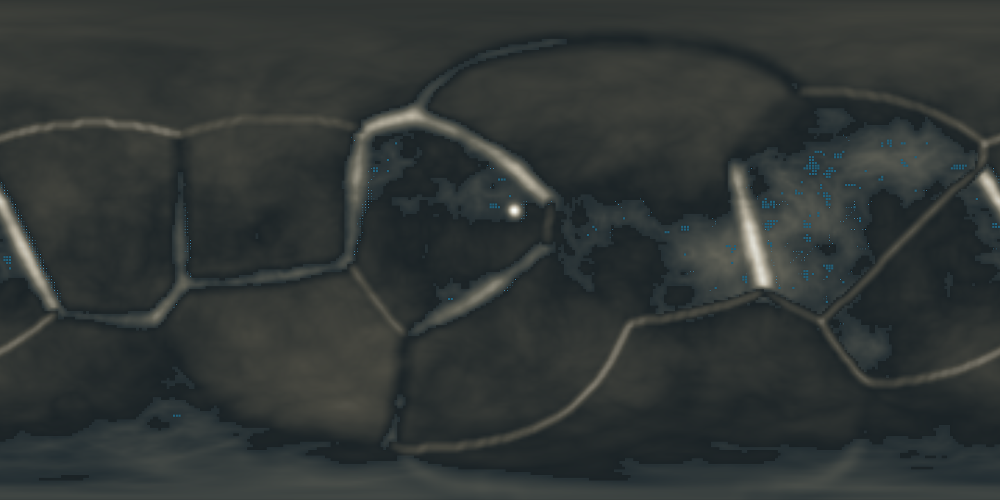
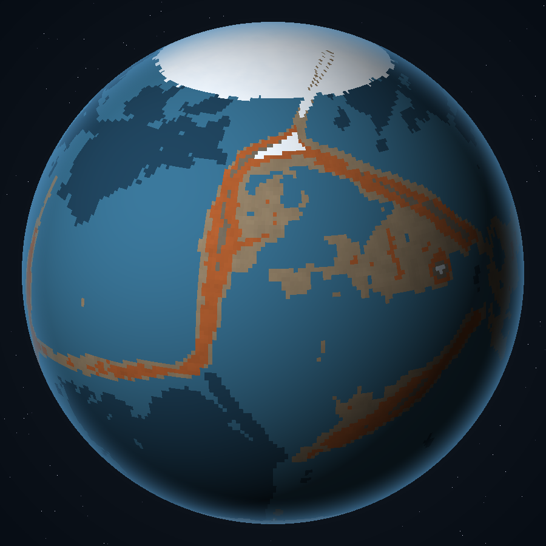
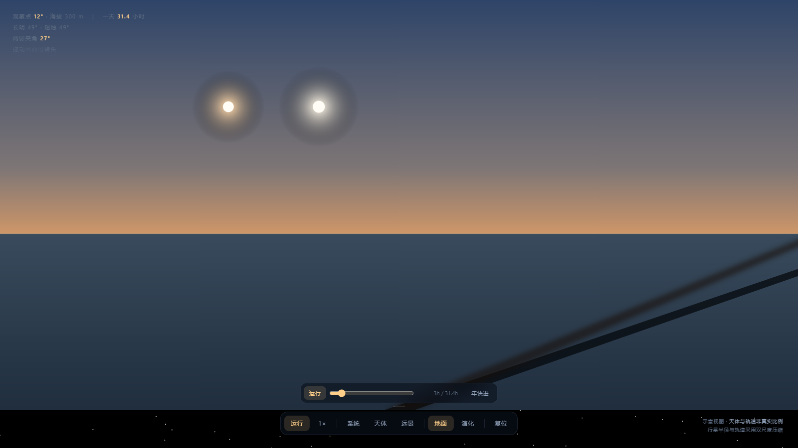
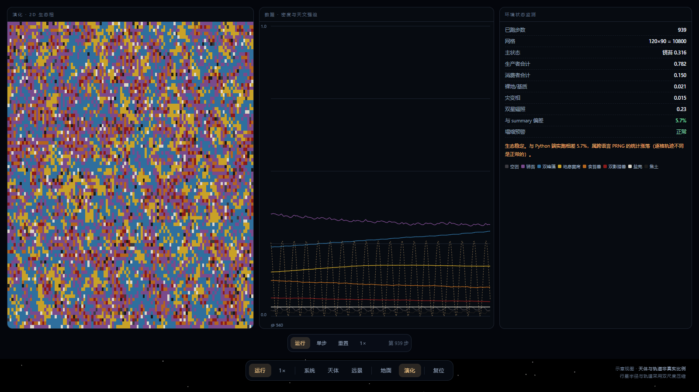

# 赫利孔 · 三阳世界

> 两个太阳，两道影子，一个从不迟到的历法。

`v1.1.1` ｜ 2026-10-27 ｜ 自洽评分 **100/100**（可发表） ｜ 生成：盘古

美学基调：`琥珀` · `钴蓝` · `铁锈` · `灰白`

---

**他们从不校准历法。历法自己就是对的——因为一年正好是八个双星周期，这是开普勒第三定律替他们签好的契约。**

天上两个太阳，一大一小，一冷一暖，绕着彼此转。地上每个人都有两道影子，一道锐利，一道模糊。一年不是十二个月，是八个「暗月」——每四十四天，小的走到大的前面，天在九十分钟里暗下去，全城停摆，祭司登塔。他们的历法从不误差，因为一年恰好是八个双星周期，这是几何的必然，不是巧合。

## 一 · 核心悖论

| 项 | 内容 |
|---|---|
| 一句话悖论 | 半径三倍于地球的岩石行星，仍保有固体地表、可呼吸大气，且天空中有两颗分色恒星同时照耀 |
| 凭什么可能 | 本世界引力常数仅为地球的 0.60 倍，使 26.4 倍地球质量的星体表面重力停在 1.76 g；双星间距被压到 0.30 AU，行星轨道恰为其 4 倍，使轨道稳定与八分历法同时成立 |
| 原始意图 | 造一个地球三倍大小、却有两个太阳的另一个世界 |

**禁忌**：魔法、超自然力量、外星文明干预、时间旅行

## 二 · 三律自检

| 律 | 内容 |
|---|---|
| 逆行律 | ✓ 半径三倍于地球的岩石行星，仍保有固体地表、可呼吸大气，且天空中有两颗分色恒星同时照耀 |
| 代价律 | ✓ 双星潮汐耦合场：地壳承受每 44 天一次的潮汐应力峰值，全球每年约 1.1 万次 4 级以上地震；造山带全部沿潮汐节拍分布 |
| 痕迹律 | ✓ 每个人在天亮后有两个影子：长明的影子边缘锐利、色偏冷灰；短烛的影子边缘模糊、边缘泛橙；两道影子的夹角随双星互绕而每日变化，正午时几乎重合成一个厚影；每四十四天一次「双星合」：短烛走到长明之前，天光在 90 分钟内从琥珀降到铁灰，气温骤降 11 度；地平线上永远能看见远灯——一颗不闪的橙红小点，30 年绕天空一圈，是唯一可靠的方位与长周期计时基准；日落后天空不是黑的，而是深的钴蓝：大气中的尘在高空散射两颗恒星的红光；厄瑞玻斯升起时，地面会出现第三道极暗的影子，古人称之为「亡影」，认为它预示死亡 |

## 三 · 宇宙

**框架**：circumbinary-superearth-hierarchical-triple ｜ **拓扑**：三维欧氏空间；内层为 0.30 AU 的双星，外层为 12 AU 的层级伴星，行星绕内双星质心公转 ｜ **有恒星**：是

### 恒星

| 名 | 光谱型 | 质量 | 光度 | 表面温度 | 轨道 |
|---|---|---|---|---|---|
| 长明 | G2V | 1.0 M☉ | 1.0 L☉ | 5780 K | 0.1352 AU / 44.5 d |
| 短烛 | K1V | 0.82 M☉ | 0.46 L☉ | 5100 K | 0.1648 AU / 44.5 d |
| 远灯 | M4V | 0.28 M☉ | 0.008 L☉ | 3300 K | 12.0 AU / 11243 d |

### 天体

| 名 | 类型 | 半径 | 质量 | 表面重力 | 特征 |
|---|---|---|---|---|---|
| 赫利孔 | planet | 19113 km | 26.4 M⊕ | 1.76 g | 主干天体。三倍地球半径，1.76 g，一天 31.4 小时，一年恰好八个双星周期 地壳以「重盐—石英」复合相为主：1.76 g 与 118 kPa 下重盐硬度接近石英，屈服强度比地球硅酸盐地壳高一个量级，因此 3R⊕ 的密度差不至于在百万年内塌陷。 |
| 厄瑞玻斯 | moon | 3504 km | 0.045 M⊕ | 0.09 g | 潮汐锁定的大卫星，稳定行星自转轴；一枚暗红的月，被称为「第三道影子」 |

### 地形与生物群系

**赫利孔**：深钴海（#1E4058） → 浅青滩（#356C8C） → 灰烬平原（#8C7B63） → 锈林（#A85A2E） → 高地岩（#6E6659） → 峰脊（#B9C4CE）

**厄瑞玻斯**：灰壤（#6A635C） → 撞击坑（#4A443E）

### 大气

- **赫利孔**：118 kPa，标高 180 km；成分 N2 66.0%、O2 19.0%、CO2 10.0%、Ar 5.0%

### 抬头能看见什么

- 每个人在天亮后有两个影子：长明的影子边缘锐利、色偏冷灰；短烛的影子边缘模糊、边缘泛橙
- 两道影子的夹角随双星互绕而每日变化，正午时几乎重合成一个厚影
- 每四十四天一次「双星合」：短烛走到长明之前，天光在 90 分钟内从琥珀降到铁灰，气温骤降 11 度
- 地平线上永远能看见远灯——一颗不闪的橙红小点，30 年绕天空一圈，是唯一可靠的方位与长周期计时基准
- 日落后天空不是黑的，而是深的钴蓝：大气中的尘在高空散射两颗恒星的红光
- 厄瑞玻斯升起时，地面会出现第三道极暗的影子，古人称之为「亡影」，认为它预示死亡

### 历法

| 项 | 值 |
|---|---|
| 一天 | 31.4 小时 |
| 一年 | 355.9 天 |
| 分月 | 8 个月 × 44.49 天 |
| 纪元 | 落火元年 |

## 四 · 物理与数学

| 常数 | 地球 | 本站 | 倍率 | 为什么改 |
|---|---|---|---|---|
| G | 6.674e-11 m3kg-1s-2 | 4.004e-11 m3kg-1s-2 | 0.60 | 唯一的核心改动。使 26.4 M⊕、3 R⊕ 的星体表面重力停在 1.76 g，固体地壳得以在自身重量下保持刚性，而非坍缩为气态包层 |
| c | 2.998e8 m/s | 2.998e8 m/s | 1.00 | 未改动。这个世界的物理学家与我们看到同样的星空红移 |
| α | 7.297e-3 | 7.297e-3 | 1.00 | 未改动。化学与光谱学因此与地球同构，元素表可直接沿用 |

### 定律

- **引力**（标准形式，常数改写）：平方反比，作用量与 G' 成正比
  - 后果：天体可以更大更轻；但恒星内部压强梯度变缓，主序寿命缩短约 15%
- **热力学第二定律**（标准）：完整保留，无例外
  - 后果：生态必须严格遵循能量金字塔；文明的一切动力都来自双星辐照的存量
- **角动量守恒**（缓慢泄漏）：在行星尺度上被双星潮汐缓慢抽取
  - 后果：自转每世纪减慢 0.002 秒；三十亿年后一天将长达 40 小时，双星合将不再精确对齐历法
- **电磁力**（标准）：标准麦克斯韦方程组
  - 后果：双星潮汐驱动的液态外核发电机维持全球磁场，极光在磁极常年可见

### 新相互作用

- **双星潮汐耦合场**｜作用域 行星半径量级（10⁴ km），随双星相位周期性振荡
  - 效果：周期性挤压行星外核，维持地磁发电机运转；同时把双星的角动量缓慢注入行星自转，使厄瑞玻斯轨道以每世纪 3.4 cm 的速度外移
  - 代价：地壳承受每 44 天一次的潮汐应力峰值，全球每年约 1.1 万次 4 级以上地震；造山带全部沿潮汐节拍分布

**守恒律**：能量严格守恒。双星轨道因引力波辐射每世纪收缩 1.2 米，三十亿年后两星合并，世界终结——这是赫利孔人早已算出的末日。

### 数学

| 项 | 值 |
|---|---|
| 几何 | 欧氏几何，三维平直空间 |
| 数系 | 实数；但计数传统源自双星，采用「双进制」口算，八与十六在他们的语言里是「整」的意思 |
| 异常 | 由于一年恰好等于八个双星周期，他们的数论中「8」具有近乎神圣的地位，所有度量衡以 8 为基 |
| 后果 | 度量衡采用八进制：一尺 = 8 寸，一斤 = 8 两。换算成地球单位会产生持续的误差，这也是他们无法发展出精密钟表的原因之一 |

## 五 · 物质

| 项 | 值 |
|---|---|
| 元素表 | 与地球完全一致（α 未改动）。唯一差异是超重元素在 Z=114 附近存在一段更宽的稳定岛，因 G' 较低使核内库仑排斥相对减弱 |
| 溶剂 | 水 |
| 键合 | 共价键与金属键并重。因重力较高，晶体生长受压制，天然形成大块单晶而非多晶集合体 |

### 标志性材料

- **曜岩**（SiO₂ 为主，含 FeTiO₃ 定向析出）：在双星双色辐照下生长的定向晶体，沿晶轴方向对不同色温的光有选择性反射：朝长明的一侧泛白，朝短烛的一侧泛橙｜用途：全部宗教建筑的外墙材料。墙面的颜色会随一日之内双星相对位置而变化，被视为「会读时间的石头」
- **赤铜**（Cu（天然单质））：因超临界水层长期还原作用，大量以天然单质形式产出，无需冶炼｜用途：最早的金属工具与货币。赫利孔人从未发明冶铜术，他们只是「捡」铜
- **重盐**（(Na,K)Cl 高压相）：在 1.76 g 与 118 kPa 下形成的致密盐相，硬度接近石英，可缓慢溶于水｜用途：建筑材料与储热介质。盐墙白天吸热、夜里放热，是灰阶诸城在「双星合」寒夜中活下来的关键

## 六 · 生命

| 项 | 值 |
|---|---|
| 能量货币 | 硫铁簇 |
| 代谢 | 地表生态以双峰光合为能量入口；深层生态以「地息」中的 H₂S 为电子供体，走化能合成路线。两条食物链在灰烬平原的裂缝带交汇，形成地球上不存在的「双源生态」 |
| 遗传载体 | 六碱基核酸（HNA） |

**光合**：色素「双峰卟啉（代号 P-590/450）」，吸收 #FFB347、#5B8FF9；观感：晨紫暮红。清晨短烛先升起，450 nm 峰主导，植被呈蓝紫；正午两星并照，双峰同时饱和，植被呈暗金属灰；黄昏长明先落，590 nm 峰主导，植被转为铁锈红

### 生态金字塔

- **初级生产者** 0.761：双峰藻（海洋）、锈苔（陆地）、地息菌（深层化能）
- **初级消费者** 0.111：浮游甲壳类、六足食苔兽、盐虫
- **次级消费者** 0.057：双影猎兽、滑翔翼龙类
- **顶级掠食者** 0.012：灰背巨蜥、渊喉（深层）
- **分解者与腐食链** 0.059：嗜热菌毯、裂缝腐食螨

**智慧生命**：灰民 —— 唯一已知智慧物种。因长期生活在 1.76 g 下，身高仅 1.2 米，骨骼密度是人类的 2.4 倍，无颈——头部直接嵌入肩胛。视觉有四色感光细胞，能分辨两道影子的色温差，这是他们最古老的天文仪器

**大灭绝**：大氧化事件（约 21 亿年前）：双峰藻把大气氧含量推到 19%，硫铁簇代谢者大批灭绝，深层生态被迫退守裂缝；双星合灾变（约 40 万年前）：一次罕见的双星近距互食使全球气温在 90 分钟内下降 27 度，87% 的陆生大型动物灭绝，灰民由此从采集转向储热定居；长夜之疫（约 1200 年前）：厄瑞玻斯轨道共振引发的潮汐高峰，全球地震频发，文明一度退回到石器时代

## 七 · 文明

| 项 | 值 |
|---|---|
| 名称 | 灰阶诸城 |
| 技术路径 | 跳过冶铜与青铜，直接从天然赤铜进入冷锻工艺；因 G' 较低而无法造出高精度弹簧与齿轮，机械技术停在凸轮与杠杆阶段，转而把全部工程天赋投向「热」——盐墙储热、地息导流、曜岩定向反光 |
| 计时 | 以双星合为「月」，一月 44.49 天，一年八个「暗月」。他们不需要闰日：一年恰好是八个双星周期，这是几何的必然（周期比 = (a_行星/a_双星)^1.5 = 4^1.5 = 8），而非巧合。历法由祭司阶层垄断，因为他们掌握唯一能预测互食时刻的曜岩日晷 |
| 能源 | 双星辐照（主要用于盐墙储热）+ 地息燃烧（深层化能产物）+ 潮汐摩擦热（地热供暖） |
| 社会 | 沿晨昏温差带分布的城邦联盟。社会阶层按「影子清晰度」划分：能在正午看清自己两道影子边界的人属上层（意味着视力好、从事天文或祭司职业）；影子糊成一团者为底层。这一划分并非迷信——四色视觉确实与营养状况强相关 |
| 禁忌 | 「不可直视双星合的正中时刻」。在互食的 90 分钟里，短烛的边缘会掠过长明，产生瞬间的强偏振光，直视会造成不可逆的视网膜灼伤。这条禁忌有明确的物理依据，是全球唯一被所有城邦共同遵守的法律 |

## 八 · 行星地图

| 项 | 推演结果 |
|---|---|
| 海洋 / 陆地 | 77.3% / 22.7% |
| 海平面 | 1.423 km ｜ 水量 7.75e+09 km³ |
| 最高峰 / 最深海 | 5.6 km / 9.895 km |
| 均温 / 年降水 | 287.79 K / 978.7 mm |
| 河流 / 湖泊 | 229 格 / 0.5% 面积 |
| 宜居度 | 均值 0.3645 ｜ 中位 0.2008 |
| 构造 | 12 块板 ｜ 汇聚 791 ｜ 张裂 786 ｜ 热点 200 |

**推演链**：板块 → 盆地 → 水量定海平面 → 年辐照定温度 → 风带与迎风坡定降水 → 洼地填充定河网 → 高程带 × 湿度定群系。 摘要哈希 `d544bcfd`（同 seed 可复算）。

**地图体检**：✓ M01 海洋占比 77.3%（水量 7.75e+09 km³）；✓ M02 最高峰 5.60 km / 重力上限 5.60 km；✓ M03 均温 287.8 K / 派生 288.1 K；✓ M04 河流格 229；✓ M05 群系覆盖 100%；✓ M06 平均宜居度 0.36

*高程与海平面 · 晕渲 + 海岸线 + 河网*

*群系 · 世界自己声明的生物群系 + 极冰 + 河网*

*年平均温度 · 年辐照、温室与海拔递减*

*年降水量 · 风带、海陆分布与雨影*

*构造 · 板块、汇聚/张裂/转换边界与热点*

*宜居度 · 温度、溶剂、光照、海拔的乘积*

*晕渲地形 · 不带群系色的纯地貌*

*正射球面 · 从太空看这颗行星*

## 九 · 历史

- **双源纪**（约 21 亿年前 – 40 万年前）双源生态的黄金时代。地表光合与深层化能两条食物链并行繁荣，生物多样性达到峰值。此期无智慧生命，只有大量巨型六足类
- **落火纪**（40 万年前 – 1200 年前）双星合灾变后，幸存者退守地热裂缝。灰民学会用重盐砌墙储热，第一批永久定居点沿断裂带建立。纪元名来自灾变当日天空的颜色
- **灰阶纪**（1200 年前 – 当下）长夜之疫后重建。八座城邦沿晨昏温差带结成联盟，曜岩日晷与八分历法成为共同语言。当下正处在一次罕见的天文事件前夜：远灯将于 12 年后穿过双星连线，三方引力叠加，可能触发新一轮潮汐高峰

## 十 · 自洽性审查

**100/100**（可发表）｜ fatal 0 ｜ warn 0

全部通过。

### 派生量核算

| 天体 | 半径 | 质量 | 密度 | 重力 | 逃逸速度 | 平衡温度 |
|---|---|---|---|---|---|---|
| 赫利孔 | 3.0 R⊕ | 26.4 M⊕ | 5.391 g/cc | 1.76 g | 33.19 km/s | 255.1 K |
| 厄瑞玻斯 | 0.55 R⊕ | 0.045 M⊕ | 1.491 g/cc | 0.089 g | 3.2 km/s | 0.0 K |

G'/G = 0.5999 ｜ 总光度 1.468 L☉ ｜ 双星间距 0.3 AU

## 十一 · 灵感来源

- [Kepler-16b — 首个被确认的环双星行星](https://science.nasa.gov/mission/kepler/) —— 绕双星公转的行星可以长期稳定存在，前提是轨道半径远大于双星间距
  - 用在哪里：为「双日照地」提供结构合法性；据此把双星间距压到 0.30 AU、行星放到 1.20 AU（k=4.0）
- [Holman & Wiegert (1999) 环双星稳定临界半径](https://ui.adsabs.harvard.edu/abs/1999AJ....117..621H) —— 稳定轨道下限约为双星间距的 2–2.5 倍，且强烈依赖双星质量比与偏心率
  - 用在哪里：确定 k=2.5 为安全线，本世界取 k=4.0 留出余量，以容纳 2.1° 的轨道倾角
- [超级地球与迷你海王星的半径分界（ Fulton et al. 2017 半径谷）](https://ui.adsabs.harvard.edu/abs/2017AJ....154..109F) —— 半径超过约 1.6–2.0 地球半径的星体，多数会吸积气体包层，失去固体表面
  - 用在哪里：本世界最容易被攻击的一点。用 G'=0.60G 偿还：密度不变而重力减半，使 3 R⊕ 的地壳得以支撑自身
- [双星系统中的光合作用色素演化（理论探讨）](https://www.astrobiology.com/) —— 不同色温的恒星会驱动光合生物演化出多吸收峰，而非单一叶绿素峰
  - 用在哪里：据此设定双峰卟啉色素，吸收 590 nm 与 450 nm，使植物呈晨紫暮红
- [开普勒第三定律与层级三合星构型](https://en.wikipedia.org/wiki/Hierarchical_triple_system) —— 层级三合星（内双星 + 远伴星）是自然界最稳定的三体构型，远伴星轨道须远大于内双星
  - 用在哪里：第三颗恒星置于 12 AU，与行星轨道 1.20 AU 相差 10 倍，满足层级稳定条件

## 十二 · 图版

*地面视角 · 站在地表抬头，两颗太阳各走各的方位角与高度角*

*生态演化 · 2D 生态相、密度曲线与天文强迫场（最近 320 步滚动窗口）*

## 名场面

双星合的那九十分钟。天空从琥珀色一层层褪到铁灰，气温骤降十一度，两道影子在广场石板上缓缓合拢成一个厚影。所有人停下手中的活，背对天空站立——不是因为敬畏，是因为直视会瞎。祭司在塔顶用曜岩日晷记录那一刻的精确角度，而城墙上的盐砖开始放出白天存下的热，白色的雾气顺着墙面升起，整座城像在呼吸。

---
*由盘古生成。设定变更请改 world.json 后重跑脚本，勿手改本文。*